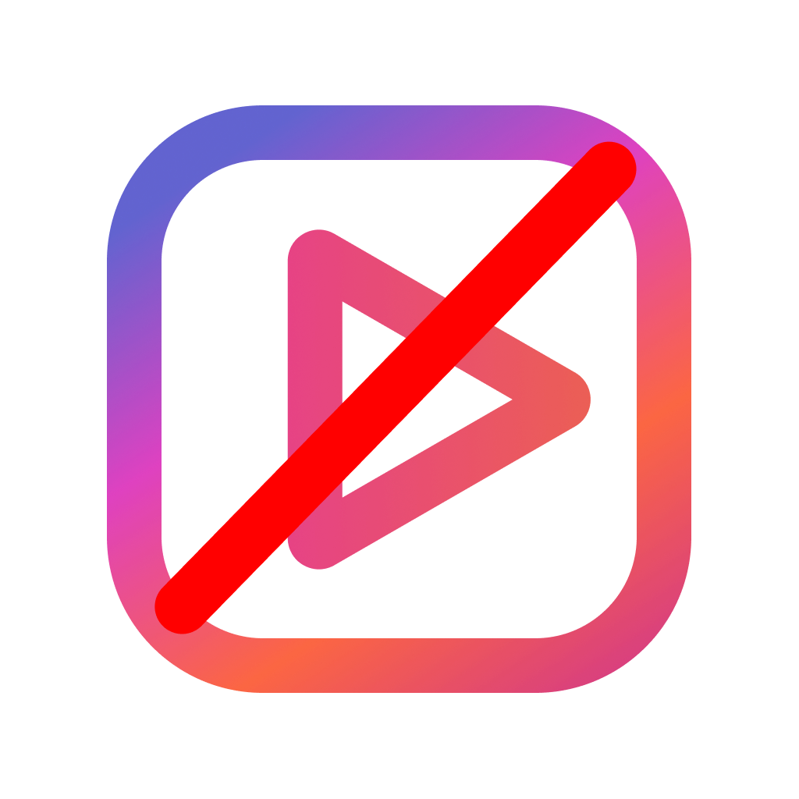

<p align="center">
  
</p>

<h1 align="center">NoReel</h1>

<p align="center">
  Use Instagram without Reels.
</p>

<p align="center">
  <a href="https://apps.apple.com/us/app/noreel-scroll-without-reels/id6760568462">Download on the App Store</a>
  &nbsp;·&nbsp;
  <a href="https://noreel.framer.website/">Privacy policy</a>
</p>

NoReel is an iOS app that lets people use Instagram's feed, Stories, search, and
direct messages while blocking Reels. It was released in March 2026 and receives
roughly 40 downloads per day.

## Features

- Blocks the Reels tab and direct navigation to Reels.
- Preserves the feed, Stories, search, comments, and direct messages.
- Optionally hides Instagram's Explore grid while keeping search available.
- Tracks time spent in the app locally and displays a daily usage heatmap.
- Supports light and dark mode.
- Collects no user data; settings and usage history remain on the device.

## How it works

NoReel embeds Instagram's mobile web experience in a React Native WebView. A
script injected before page load hides Reels navigation, rejects Reels routes,
and reports client-side route changes to the native layer. The app also patches
`IntersectionObserver` behavior in `WKWebView` so Instagram's infinite feed can
continue loading reliably during touch scrolling.

Authentication stays between the user and Instagram. NoReel does not receive or
store Instagram credentials.

## Technology

- TypeScript and React Native
- Expo and Expo Router
- React Native WebView
- AsyncStorage for on-device settings and usage history
- React Native Reanimated and SVG
- EAS Build for iOS releases

## Local development

Requirements: Node.js 20 or newer, pnpm 10, Xcode, and an iOS Simulator.

```sh
pnpm install --frozen-lockfile
pnpm ios
```

Quality checks:

```sh
pnpm lint
pnpm typecheck
pnpm export:web
```

## Project status

NoReel was built and shipped as a focused product project. This repository is
maintained as a portfolio snapshot rather than an actively developed roadmap.

## Disclaimer

NoReel is not affiliated with, endorsed by, or sponsored by Instagram or Meta.
Instagram is a trademark of Meta Platforms, Inc.

## License

This project is available under the [MIT License](LICENSE).
